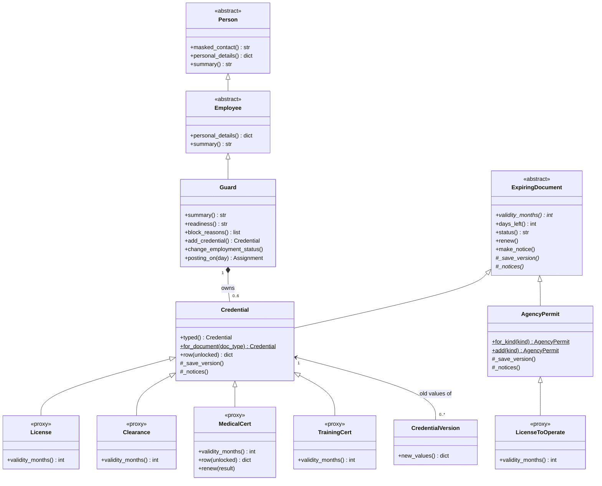
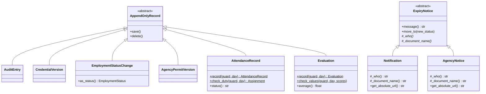
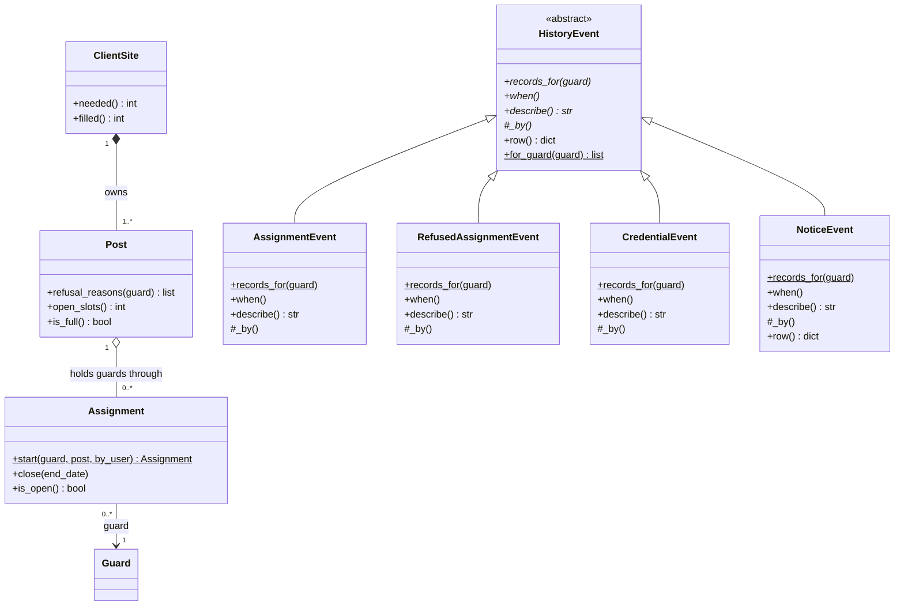
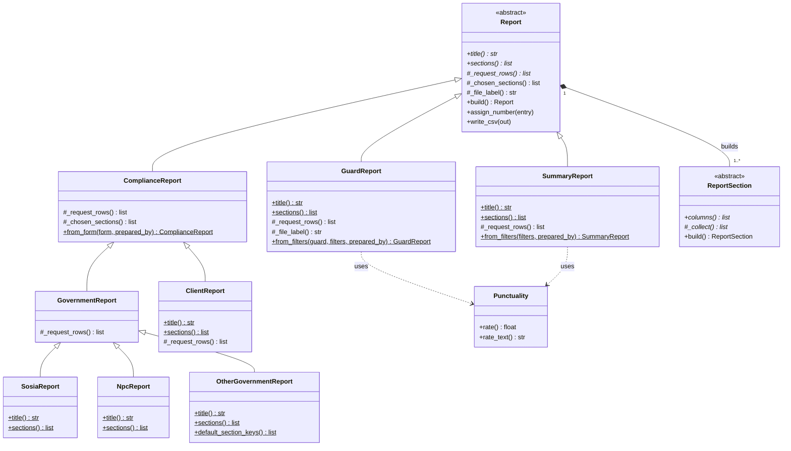
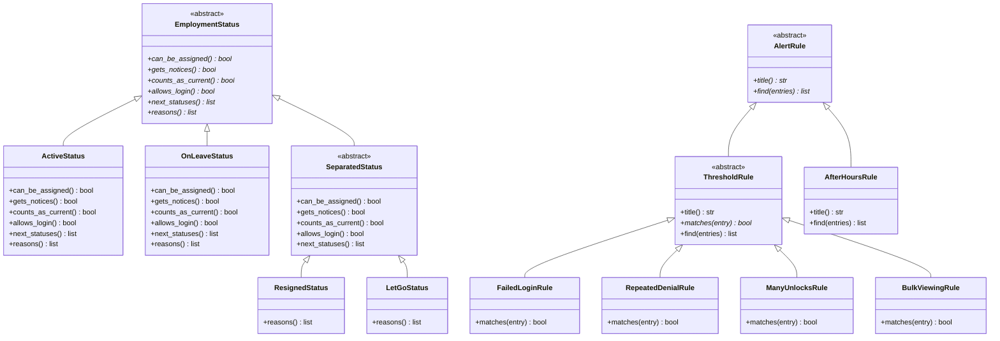

# GuardReady: OOP Map

This page shows where each OOP idea is in the GuardReady code, for the IT102
panel. It follows the professor's reference, practice activity 10 (the
Balaman Bank app). Every class, method and file named here exists in the code.
A script checked all of them on October 17, 2026.

GuardReady has about 120 classes in 5 Django apps: `accounts`, `guards`,
`deployment`, `audit` and `reports`.

---

## 1. Side by side with the Balaman Bank activity

| Balaman Bank | GuardReady | File |
| --- | --- | --- |
| `BankAccount(ABC)` with `@abstractmethod` | `Report(ABC)`: `title()`, `sections()` and `_request_rows()` are abstract | `reports/base.py` |
| Two subclasses override the abstract methods | `GuardReport`, `SummaryReport` and the compliance reports (`SosiaReport`, `NpcReport`, `OtherGovernmentReport`, `ClientReport`) override them | `reports/guard_reports.py`, `reports/compliance.py` |
| `_pin` and `_balance`, protected with one underscore | `Report` keeps `_period_start`, `_period_end` and `_entry_id`. `Punctuality` keeps `_counts`. | `reports/base.py`, `reports/guard_reports.py` |
| `get_x()` accessor methods | Read-only `@property` accessors, like `Report.number` and `Punctuality.on_time` | `reports/base.py`, `reports/guard_reports.py` |
| `ACCOUNT_TYPES` dict and `create_account()` factory | `COMPLIANCE_REPORTS` and `compliance_report_class()`, `PERMIT_TYPES` and `AgencyPermit.for_kind()`, `CREDENTIAL_CLASSES` and `typed()`, `STATUS_CLASSES` | `reports/compliance.py`, `guards/models.py`, `guards/status.py` |

What to say: "We used the same ideas as the Balaman Bank activity. The
abstract base class is `Report`, the subclasses override its methods, the data
is protected with one underscore and read through properties, and a dictionary
picks the class, like `ACCOUNT_TYPES`."

---

## 2. Abstraction

An abstract class is a plan that is never used by itself. Its subclasses fill
in the missing parts.

| Where | What to say |
| --- | --- |
| `Report(ABC)` and `ReportSection(ABC)` in `reports/base.py` | One base class for every report and one for every table in a report. `title()`, `sections()`, `_request_rows()`, `columns()` and `_collect()` are abstract. |
| `EmploymentStatus(ABC)` in `guards/status.py` | Each status (Active, On leave, Resigned, Let go) must answer `can_be_assigned()`, `gets_notices()`, `counts_as_current()`, `allows_login()`, `next_statuses()` and `reasons()`. `SeparatedStatus` stays abstract, because each way of leaving has its own `reasons()`. |
| `AlertRule(ABC)` in `audit/alerts.py` | Every security alert rule has `title()` and `find()`. `ThresholdRule` stays abstract, because `matches()` is abstract. |
| `HistoryEvent(ABC)` in `audit/history.py` | Every event in a guard's History tab has `records_for()`, `when()`, `describe()` and `_by()`. |
| Abstract models `AppendOnlyRecord`, `Person`, `Employee`, `ExpiringDocument` and `ExpiryNotice` | They have no table of their own. `ExpiringDocument.validity_months()` raises `NotImplementedError` until `typed()` picks the real class. |
| `SectionForm` (`guards/forms.py`) and `PerformanceForm` (`reports/forms.py`) | Base forms that are never used by themselves. `PerformanceForm._check()` raises `NotImplementedError`. |

Why the models do not use `ABC`: a Django model already has its own
metaclass, and it clashes with `ABCMeta`. So model bases use
`class Meta: abstract = True`, and their base methods raise
`NotImplementedError`, like `validity_months()`.

---

## 3. Inheritance

| Family | Levels |
| --- | --- |
| `Person` → `Employee` → `Guard` | 3 |
| `ExpiringDocument` → `Credential` → `License`, `Clearance`, `MedicalCert`, `TrainingCert` (proxy models that share one table) | 3 |
| `ExpiringDocument` → `AgencyPermit` → `LicenseToOperate` | 3 |
| `ExpiryNotice` → `Notification`, `AgencyNotice` | 2 |
| `AppendOnlyRecord` → `AuditEntry`, `CredentialVersion`, `EmploymentStatusChange`, `AgencyPermitVersion`, `AttendanceRecord`, `Evaluation` | 2 |
| `EmploymentStatus` → `ActiveStatus`, `OnLeaveStatus`, `SeparatedStatus` → `ResignedStatus`, `LetGoStatus` | 3 |
| `AlertRule` → `ThresholdRule` → `FailedLoginRule`, `RepeatedDenialRule`, `ManyUnlocksRule`, `BulkViewingRule`, and `AlertRule` → `AfterHoursRule` | 3 |
| `HistoryEvent` → `AssignmentEvent`, `RefusedAssignmentEvent`, `CredentialEvent`, `NoticeEvent` | 2 |
| `Report` → `ComplianceReport` → `GovernmentReport` → `SosiaReport`, `NpcReport`, `OtherGovernmentReport` | 4 |
| `Report` → `ComplianceReport` → `ClientReport`, and `Report` → `GuardReport`, `SummaryReport` | 3 |
| `ReportSection` → 12 compliance tables (some through `AuditLogSection` and `ClientSection`) and 4 guard report tables (`PeriodSummarySection`, `AttendanceSection`, `EvaluationSection`, `GuardListSection`) | 3 |
| `SectionForm` → `ExpiringDocumentForm` → `CredentialForm` → `RenewCredentialForm` → `MedicalRenewCredentialForm` | 5 |
| `ComplianceRequestForm` → `GovernmentRequestForm`, `ClientRequestForm`; `ReportPeriodForm` → `SummaryFilterForm`; `PerformanceForm` → `AttendanceForm`, `EvaluationForm` | 2 |
| `ReadOnlyAdmin` → `AuditEntryAdmin` and the other Django admin pages | 2 |
| `RecordLockedError` (our own exception) extends `Exception` | 2 |

A subclass that adds to a parent method calls `super()` instead of copying
code. Examples: `Guard.summary()` adds the guard type to `Employee.summary()`,
`MedicalCert.row()` adds the result, and `GuardReport._file_label()` adds the
employee number.

What to say: "`Guard` inherits from `Employee`, and `Employee` inherits from
`Person`. Our longest chain is 5 levels, from `SectionForm` down to
`MedicalRenewCredentialForm`."

---

## 4. Polymorphism

One method call, and each class answers in its own way. There is no if/elif
on the type anywhere. A dictionary picks the class once, then the code just
calls the method.

| The call | Who answers |
| --- | --- |
| `validity_months()` | Each paper class: `License`, `Clearance`, `MedicalCert`, `TrainingCert` and `LicenseToOperate`. |
| `make_notice()`, called by `check_expiry()` | Guard papers and agency permits alike, because both are an `ExpiringDocument`. Each class names its own notices in `_notices()`, and its own old versions in `_save_version()` for `renew()`. |
| `row()` and `renew()` | `MedicalCert` hides the result until an unlock, and its `renew()` also takes a new result. |
| `write_csv()`, the one CSV writer in `Report` | It calls `title()`, `header_rows()` and each table's `columns()`, so every report gets a CSV file without its own CSV code. |
| `_chosen_sections()` and `_file_label()` | `ComplianceReport` builds only the ticked tables. `GuardReport` adds the employee number to the file name. |
| `find()` and `matches()` | Each security alert rule. The Security alerts page calls `find()` on every rule in `ALERT_RULES`. |
| `records_for()`, `when()`, `describe()` and `_by()` | Each history event. `history_for()` asks every class in `HISTORY_EVENTS`. |
| `can_be_assigned()`, `gets_notices()`, `allows_login()` and `refusal_reason()` | Each employment status. `Post.refusal_reasons()` asks the status object, so an On leave or Resigned guard is refused without any if/elif. |
| `message()`, `_who()`, `_document_name()` and `get_absolute_url()` | `Notification` names the guard, and `AgencyNotice` names the agency. |
| `_check()` | `AttendanceForm` asks `AttendanceRecord.check_duty()`, and `EvaluationForm` asks `Evaluation.check_values()`. The shared `clean()` in `PerformanceForm` calls it. |

What to say: "`check_expiry()` does not know if a paper belongs to a guard or
to the agency. It just calls `make_notice()`, and each class does its own
part."

---

## 5. Encapsulation

The data is protected, and it changes only through methods that check a rule.

| Where | What to say |
| --- | --- |
| `Credential.renew()` and `Guard.add_credential()` | The only ways to change or add a guard's paper. `renew()` saves the old values in a `CredentialVersion` first. |
| `AgencyPermit.add()` and `renew()` | The only ways to put the LTO on file and to change it. |
| `Assignment.start()` and `Assignment.close()` | A posting starts only through `start()`, and `close()` works once. |
| `Guard.change_employment_status()` | The only way to change a status. It also closes the open posting and turns the login off or on. |
| `AttendanceRecord.record()` and `Evaluation.record()` | The only ways to add a duty or an evaluation. They check the rules first. The post and the shift start come from that day's posting, never from the form. |
| `ExpiryNotice.move_to()` | A notice only moves forward: New, Seen, Resolved. |
| `AppendOnlyRecord.save()` and `delete()`, and `AppendOnlyQuerySet` | Editing or deleting an audit entry, an old version, a status change, attendance or an evaluation raises `RecordLockedError`. |
| `Report.assign_number()` | A report gets its number only once, from its REPORT audit entry. |
| Protected attributes with read-only properties | `Report` (`_period_start`, `_entry_id`), `Punctuality` (`_counts`), `Alert`, `HistoryEvent` (`_record`), the status objects (`_change`), `RenewCredentialForm` (`_old`) and `PerformanceForm` (`_guard`). |
| `Person.masked_contact()` and `personal_details()` | The contact number is masked, and personal details show only after an unlock. `ChangeSummary` saves only the name of a sensitive field, never its value. |

Why the Django fields are public: Django needs model fields to be public, so
GuardReady protects the rules instead. Fields change only through the methods
above, and `save()` and `delete()` block the changes that are not allowed.

---

## 6. Relationships

| Kind | Where |
| --- | --- |
| Composition (owns, and the part does not live alone) | A `Guard` owns its `Credential` papers. A `ClientSite` owns its `Post` rows. A `Report` owns the tables it builds. `AddGuardForms` owns the 9 section forms of the Add Guard page. |
| Aggregation (holds, but the part lives on its own) | A `Post` holds guards through `Assignment` rows. A guard exists on its own and can move to another post. |
| Association (points to) | An `AuditEntry` points to the user who acted. A `ClientReport` is tied to one `ClientSite`. An `AttendanceRecord` points to the post the guard worked that day, found by `Guard.posting_on()`. An `Evaluation` points to the evaluator. Each `HistoryEvent` wraps one record. |

---

## 7. Factories: pick the class once

| Factory | What it picks |
| --- | --- |
| `Credential.typed()` with `CREDENTIAL_CLASSES` | The paper class from the `kind` field, with no extra query. `Credential.for_document()` builds an unsaved sample. |
| `AgencyPermit.for_kind()` with `PERMIT_TYPES` | The permit class, like `LicenseToOperate`. |
| `EmploymentStatusChange.as_status()` with `STATUS_CLASSES` | The status class. |
| `compliance_report_class()` with `COMPLIANCE_REPORTS` | The compliance report class. `make_form()` and `from_form()` build its form and the report. |
| `add_form_class()` and `renew_form_class()` with `CREDENTIAL_FORMS` and `RENEW_FORMS` | The document form, by asking `uses_result()`. |
| `NOTICE_TYPES` | The notice class for a guard notice or an agency notice. |
| `HistoryEvent.for_guard()` with `HISTORY_EVENTS` | One event object per record. |
| `GuardReport.from_filters()` and `SummaryReport.from_filters()` | A report built from the filter form. |
| `Assignment.start()`, `AttendanceRecord.record()` and `Evaluation.record()` | A new record, created only after the rules pass. |

---

## 8. Class diagrams

GitHub draws these as pictures. To edit one or save it as a PNG, paste it into
https://mermaid.live. A method in italics (`*` in the code) is abstract, and
one that is underlined (`$`) is a class method or a static method. `title()`,
`sections()` and `records_for()` are abstract class methods.

### People and papers

### Records that can only be added, and notices

### Deployment and history

### Reports

### Employment status and security alerts

---

## 9. Questions the panel may ask

**Why are your Django fields public if you use encapsulation?**
Django needs model fields to be public. So GuardReady protects the rules
instead: a field changes only through a method like `renew()` or `close()`, and
`save()` and `delete()` refuse the changes that are not allowed.

**Why do your models not inherit from `ABC`?**
A Django model already has a metaclass, and it clashes with `ABCMeta`. So the
model bases use `abstract = True` and raise `NotImplementedError`. Our plain
Python classes, like `Report` and `AlertRule`, do use `ABC`.

**Where is polymorphism without if/elif?**
`check_expiry()` calls `make_notice()` on guard papers and agency permits
alike. `Report.write_csv()` writes every report. `Post.refusal_reasons()` asks
the status object instead of checking the status name.

**What happens if someone tries to edit an audit entry?**
`AppendOnlyRecord.save()` raises `RecordLockedError`, and so do `delete()` and
the bulk `update()` and `delete()` in `AppendOnlyQuerySet`. Django does not
even create change or delete permissions for these models. SQLite can still be
changed outside the app, so a real build should use PostgreSQL with an
insert-only audit table.

**How does Zero Trust use your classes?**
`ROLE_PERMISSIONS` in `accounts/roles.py` is the only list of what each role
can do. The `access_required` decorator checks the permission on every
request, and `can_view_guard()` checks the guard itself. `AuditMiddleware` logs
every view and every refusal into `AuditEntry`, which can only be added.

**Why is there only one CSV writer?**
Shared steps belong in the base class. `Report.write_csv()` writes any report,
because it only calls the methods every report must have. A new report gets a
CSV file for free.
